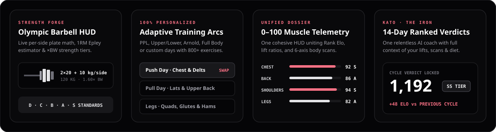

 

---

## Why I Built This

I finally wanted to build **the best all-in-one, smooth gym experience there is**.

Every time I trained, I was bouncing between four or five different apps that didn't talk to each other: one clunky tracker for sets and reps, a bloated calorie app for macros, the iPhone Notes app for PRs, and camera roll folders full of progress photos with zero objective feedback. Worse, almost every fitness app feels like filling out spreadsheets between sets.

**Kizen (Project Ascension)** is my answer to that:

- **Effortless & Fun to Use**: Zero-scroll dark HUD surfaces designed for one-handed use in the middle of a workout. No spreadsheet fatigue, no clutter, no wasted taps.
- **Absolute Customization & Personalization**: From your weekly split (`PPL`, `Upper / Lower`, `Arnold`, `Full Body`, or custom schedules) down to every single exercise slot, macro target, and bodyweight-calibrated strength standard—the entire system adapts 100% around your body, equipment, and goals.
- **Real Telemetry, Not Gimmicks**: Everything you log—your lifts, your nutrition, and your physique scans—feeds into one unified progression engine and a 14-day Ranked Verdict (`E` → `SSS`).

---

## Live Preview & Access

> 🔒 **Live App Link**: **[Coming Soon — Security Hardening & Closed Alpha in Progress](#)**
>
> *The live production deployment is currently locked while authentication, row-level security, and API rate-limiting passes are finalized. The public beta link will drop right here once security sign-off is complete.*

---

## System Overview

  

### 1. Absolute Personalization From Day One
- **Custom Training Arcs**: Pick a recommended split tailored to your weekly schedule and experience level, or customize every training day individually.
- **800+ Exercise Library with Visual Previews**: Swap any movement in any workout or PR slot in one tap, filtered by muscle group, sub-focus (`Quad Focus`, `Upper Back`, `Lateral Delts`), and available equipment.
- **Same-Day Focus Swap**: Gym crowded or feeling beat up? Swap today's scheduled focus (`Push` ↔ `Pull` ↔ `Legs`) straight from the home Gate without breaking your weekly rhythm.

### 2. The Strength Forge (Not Another Notes App)
- **Live Olympic Barbell Schematic**: Automatically calculates and visualizes the exact per-side plate stack on a standard `20 kg` / `45 lb` bar (`2×20 + 10 + 2.5 kg / side`) as you dial in your lift.
- **Sex- & Bodyweight-Calibrated Standards**: Every compound and isolation lift is scored against `D · C · B · A · S` tier milestones scaled to your bodyweight (`×BW` ratios).
- **Built-In 1RM Epley Calculator**: Enter a working set (`Weight × Reps`) and apply your estimated 1-rep max in a single tap.

### 3. Frictionless AI Nutrition & Macro Engine
- **AI Vision Meal Scanner**: Snap a photo of your plate or scan a barcode to break down calories, protein, carbs, and fats in seconds.
- **Adaptive Macro Targets**: Automatically computes BMR, TDEE, and daily protein/calorie targets from your biometrics and active goal stack (lean bulk, recomposition, or cut).

### 4. Unified Biometric Dossier & 3-Pose Body Scan
- **3-Angle Biometric Capture (`Front ∠00° · Back ∠180° · Legs ∠90°`)**: Guided anatomical pose rigs score your physique on a unified `0–100` scale across six muscle groups (`Chest`, `Back`, `Shoulders`, `Arms`, `Core`, `Legs`) with body-fat estimation and a 90-day prognosis.
- **One Cohesive Stats Hub**: No fragmented sub-apps—your Main Rank trajectory, Strength Portfolio, Biometric Muscle Map, and Cycle Verdict History live in one clean dossier.

### 5. Kato (`THE IRON`) & 14-Day Ranked Verdicts
- **One Coach Who Actually Knows Your Numbers**: **Kato** has persistent memory of your training split, PR portfolio, macro adherence, and latest body scan. No generic templates—just direct, data-backed adjustments.
- **14-Day Council Verdict**: Every two weeks, lock in your PRs, consistency, and physique scan for an immutable cycle evaluation that updates your global Main Rank (`E` through `SSS`).

---

## Tech Stack

| Layer | Technology |
| :--- | :--- |
| **Framework** | Next.js 14 (App Router), React 18, TypeScript |
| **Styling & Motion** | Tailwind CSS, Framer Motion, Procedural SVG HUD Rigging |
| **Backend & Auth** | Supabase (PostgreSQL, Auth, Storage), Row-Level Telemetry |
| **AI & Vision** | Multimodal Vision Pipeline (Meal Decomposition, 3-Pose Physique Scoring, Kato Debriefs) |

---

## Repository Note

This repository serves as the **public showcase and product overview** for **Kizen (Project Ascension)**.
The core application source code is maintained in a private repository while pre-launch security hardening is completed.
